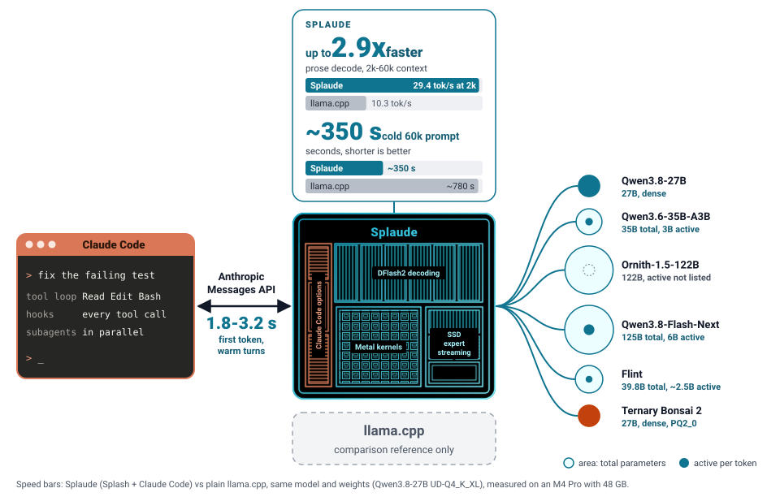
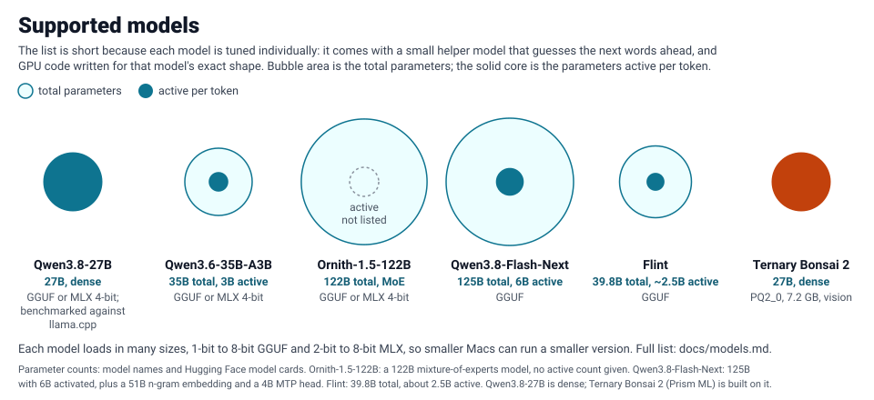
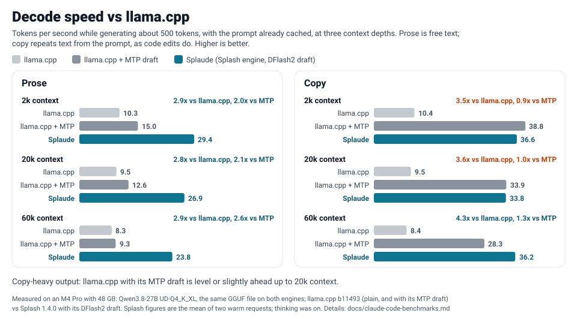
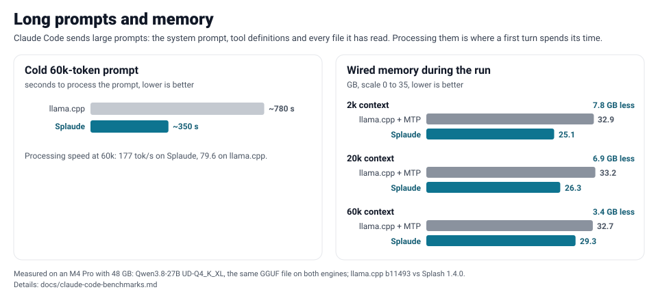
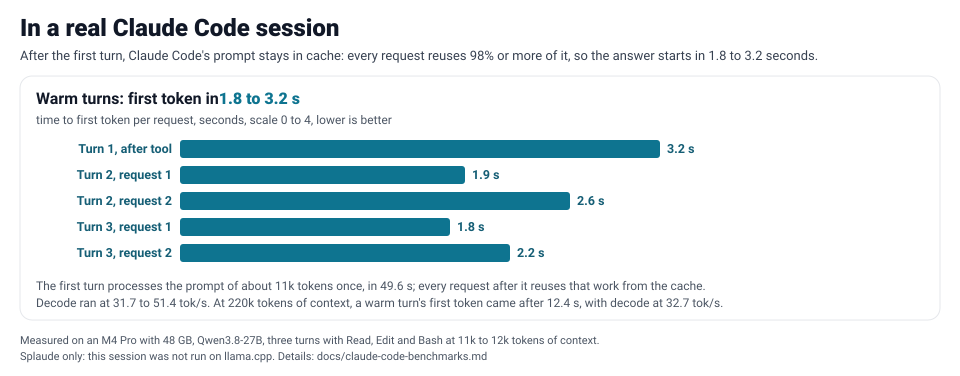
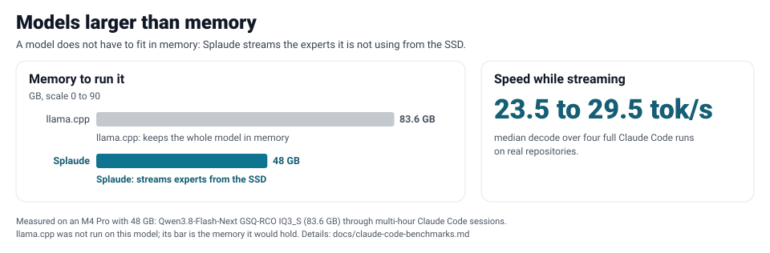

# Splaude

**Claude Code, running on your own Mac.** Private and free: nothing leaves your machine.

## Get started

1. Install:

```bash
brew install pcvelz/tap/splaude
```

2. Run:

```bash
splaude
```

Claude does the rest.

Rather set it up yourself? See [Manual installation](#manual-installation).

## How it works

[](https://pcvelz.github.io/splaude/claude-code-overview.html)

Splaude is a fork of [Splash](https://github.com/incoai/splash), a local inference
engine for Apple silicon, with the server options
[Claude Code](https://docs.anthropic.com/en/docs/claude-code) needs. Start one
server, point Claude Code at it, and the full harness runs locally: the tool
loop, hooks, subagents and long contexts. No API key, and no tokens leave the
machine. Against llama.cpp on the same model and Mac, it decodes up to 4x as
fast and prefills over 2x as fast, and it runs models larger than memory by
loading unused weights from the SSD on demand
([comparison](docs/claude-code-benchmarks.md)).

## Manual installation

Needs an Apple M3 or newer with macOS 26.4 or later. Start the server:

```bash
splaude serve --model unsloth/Qwen3.8-Flash-Next-GGUF:UD-Q4_K_XL \
  --accept-any-model --sampling-headers \
  --sampling-default temperature=1.0 --sampling-default top_p=0.95 \
  --sampling-default top_k=20 --sampling-default min_p=0 \
  --max-context 262144 --kv-format int8 --idle-release off
```

Swap in a `--model` that fits your Mac's memory:

| Your Mac | Model | Download |
|---|---|---|
| 24 GB | `unsloth/Qwen3.8-27B-GGUF:UD-IQ3_XXS` | 16 GB |
| 36 GB or more | `unsloth/Qwen3.8-27B-GGUF:UD-Q4_K_M` | 21 GB |
| 64 GB | `ISTA-DASLab/Qwen3.8-Flash-Next-GSQ-RCO-GGUF:Q2_0` | 69 GB |
| 96 GB or more | `ISTA-DASLab/Qwen3.8-Flash-Next-GSQ-RCO-GGUF:IQ3_S` | 86 GB |

When it prints `Ready`, start Claude Code in a second terminal:

```bash
ANTHROPIC_BASE_URL=http://127.0.0.1:8000 ANTHROPIC_AUTH_TOKEN=local \
API_TIMEOUT_MS=86400000 CLAUDE_STREAM_IDLE_TIMEOUT_MS=86400000 \
CLAUDE_CODE_DISABLE_NONSTREAMING_FALLBACK=1 \
claude
```

`ANTHROPIC_BASE_URL` points Claude Code at Splaude; the token can be any value,
it only skips the login. The timeouts let Claude Code wait out a long first
prompt.

## Models

The list is short because each model is tuned individually: it comes with a
small helper model that guesses the next words ahead, and GPU code written for
that model's exact shape.



| Model | Example |
|---|---|
| Qwen3.8-Flash-Next | `ISTA-DASLab/Qwen3.8-Flash-Next-GSQ-RCO-GGUF:IQ3_S` |
| Qwen3.8-27B | `unsloth/Qwen3.8-27B-GGUF:UD-Q4_K_M` |
| Qwen3.6-35B-A3B | `unsloth/Qwen3.6-35B-A3B-GGUF:UD-Q4_K_M` |
| Ornith-1.5-122B | `unsloth/Ornith-1.5-122B-GGUF:UD-Q4_K_XL` |
| Flint | `unsloth/flint-GGUF:UD-Q4_K_XL` |
| Ternary Bonsai 2 | `prism-ml/Ternary-Bonsai-2-27B-gguf:PQ2_0` (7.2 GB) |

Each model loads in many sizes, 1-bit to 8-bit GGUF and 2-bit to 8-bit MLX,
so smaller Macs can run a smaller version. Full list: [models](docs/models.md).

## Performance

Speed bars: Splaude (Splash + Claude Code) vs plain llama.cpp, same model and
weights (Qwen3.8-27B UD-Q4_K_XL). Details: [comparison](docs/claude-code-benchmarks.md).

### Decode speed

Tokens per second while generating about 500 tokens, with the prompt already
cached, at three context depths. Prose is free text; copy repeats text from the
prompt, as code edits do. Higher is better.



Copy-heavy output: llama.cpp with its MTP draft is level or slightly ahead up to 20k context.

### Long prompts and memory

Claude Code sends large prompts: the system prompt, tool definitions and every
file it has read. Processing them is where a first turn spends its time.



Processing speed at 60k: 177 tok/s on Splaude, 79.6 on llama.cpp.

### In a real Claude Code session

After the first turn, Claude Code's prompt stays in cache: every request reuses
98% or more of it, so the answer starts in 1.8 to 3.2 seconds.



### Models larger than memory

A model does not have to fit in memory: Splaude streams the experts it is not
using from the SSD.



## What Splaude adds

Every option is off unless you set it, so without them Splaude behaves like Splash.

**For Claude Code**

| Option | What it does | Upstream |
|---|---|---|
| `--accept-any-model` | Serves every model name Claude Code asks for, including its title and summary requests, with the loaded model. | fork only |
| `--reasoning off` | Never think, whatever the request asks. The default, `auto`, lets each request decide. | [#615](https://github.com/incoai/splash/pull/615) |
| `--sampling-default NAME=VALUE` | Claude Code sends no sampling settings; these become the defaults. | [#614](https://github.com/incoai/splash/pull/614) |
| `--sampling-headers` | Set sampling per session through headers, e.g. `ANTHROPIC_CUSTOM_HEADERS=$'X-Temperature: 0.7'`. | [#618](https://github.com/incoai/splash/pull/618) |
| `--chat-template-file FILE` | Use your own chat template. | fork only |

**For supervisors and proxies**

| Option | What it does | Upstream |
|---|---|---|
| `--engine-failure exit` | Exit when the engine fails, so the supervisor restarts it. | [#617](https://github.com/incoai/splash/pull/617) |
| `--spawn-guard COMMAND` | Run a check before every engine start. | [#637](https://github.com/incoai/splash/pull/637) |
| `--llama-cpp-compat` | llama.cpp-style `/slots`, `/props` and `id_slot`, for proxies such as [llama-swap](https://github.com/pcvelz/llama-swap-macos-extended). | [#638](https://github.com/incoai/splash/pull/638) |
| `-m` / `--model-file PATH` | Report which model file is served. | fork only |
| (relaunch) | A new engine starts only after the old one exits. | merged, [#616](https://github.com/incoai/splash/pull/616) |

## More

Splaude is Splash with the options above, so everything else in Splash applies
unchanged: [API](docs/api.md), [settings](docs/server.md),
[performance](docs/performance.md), [how it works](https://inco.ai/blog/splash/).

## License

Apache-2.0; see [third-party notices](THIRD_PARTY_NOTICES).
